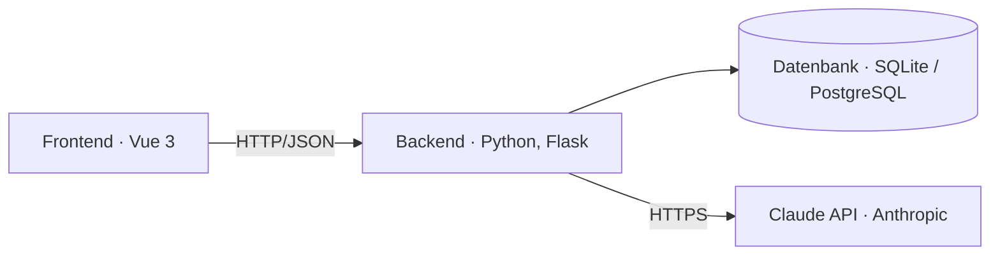

# PaceMaker

Freizeitläuferinnen und -läufer sammeln mit ihrer Uhr über Jahre
Trainingsdaten, die als lose Liste vorliegen. PaceMaker importiert diese Läufe
aus Garmin Connect, verbindet sie mit dem persönlichen Trainingsziel und lässt
von Claude eine verständliche Trainingsempfehlung dazu schreiben.

Semesterarbeit im Modul Softwareentwicklung, MSc Wirtschaftsinformatik HSLU,
Herbstsemester 2026.

**Live:** [pacemaker-ian3.onrender.com](https://pacemaker-ian3.onrender.com/)
Demo-Konto: `demo@pacemaker.ch`, Passwort `laufen123`

## Funktionen

- Läufe aus Garmin Connect importieren (CSV) oder von Hand erfassen
- Logbuch anzeigen, sortieren und Läufe löschen
- Trainingsziel und Wettkampf erfassen
- Trainingsempfehlung von Claude zu vier vorgegebenen Fragen

## Aufbau



Details in der [Architektur](docs/architektur.md), die Technologieentscheide in
[docs/decisions](docs/decisions/).

| Was | Wo |
|---|---|
| Einstiegspunkt | `src/app/__init__.py` (`create_app()`) |
| Datenmodell, Anfangsdaten | `src/app/models.py`, `src/app/seed.py` |
| Fachlogik und API | `src/app/trainings.py`, `garmin.py`, `goals.py`, `recommendation.py` |
| Aufruf der externen API | `src/app/ki_service.py` |
| Frontend | `src/app/static/index.html` |
| Tests | `tests/` |
| CI | `.github/workflows/tests.yml` |
| Deployment | `Dockerfile`, Render |
| Secrets | `.env` lokal, Umgebungsvariablen auf Render, Vorlage in `.env.example` |
| Abhängigkeiten | `pyproject.toml`, `uv.lock` |

## Lokal starten

Voraussetzung ist [uv](https://docs.astral.sh/uv/).

```bash
uv sync --locked --all-groups
cp .env.example .env
uv run flask --app app init-db
uv run flask --app app run --debug
```

Danach unter http://localhost:5000 erreichbar. Für die Empfehlungen braucht
es einen `ANTHROPIC_API_KEY` in der `.env`.

## Tests

```bash
uv run pytest
```

Die Tests laufen mit einer Datenbank im Arbeitsspeicher und einer Attrappe des
KI-Service, also ohne echte Datenbank und ohne API-Schlüssel.

## Deployment

Jeder Pull Request startet in GitHub Actions Lint und Tests. Ein roter Lauf
sperrt den Merge. Nach einem Merge auf `master` deployt Render automatisch,
sobald die Prüfungen grün sind.

## Team

Simon Gnos, Samuel Hofer, Raphael Bieri, Marija Cirkovic
