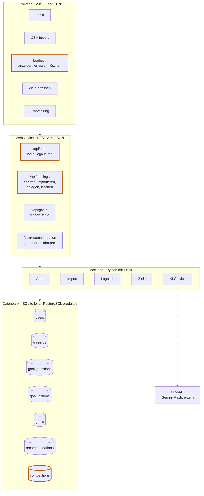

# Architektur PaceMaker

Stand: 2026-10-20 · Grundlage: [anforderungen.md](anforderungen.md),
[decisions/0001-technologiewahl.md](decisions/0001-technologiewahl.md) und
[decisions/0003-datenmodell.md](decisions/0003-datenmodell.md)

## Übersicht

Die Anwendung besteht aus vier Schichten. Jede Schicht spricht nur mit der
direkt darunterliegenden. Das Sprachmodell ist ein externer Dienst, den
ausschliesslich der KI-Service im Backend aufruft — nie das Frontend direkt,
damit der API-Schlüssel den Server nicht verlässt.

Orange umrandet sind die Bausteine, die gegenüber der ersten Fassung der
Architektur angepasst wurden (siehe unten).

## Bausteine und zugehörige Anforderungen

| Endpunkt | Operationen | Backend-Modul | Datei | Tabellen | Anforderungen |
|---|---|---|---|---|---|
| `/api/auth` | login, logout, me | Auth | `auth.py` | `users` | FA-A1 bis FA-A5 |
| `/api/trainings` | abrufen, importieren, anlegen, löschen | Import, Logbuch | `trainings.py`, `garmin.py` | `trainings` | FA-I1 bis FA-I8, FA-L1 bis FA-L7 |
| `/api/goals` | fragen, ziele | Ziele | `goals.py` | `goal_questions`, `goal_options`, `goals`, `competitions` | FA-Z1 bis FA-Z5 |
| `/api/recommendation` | generieren, abrufen | KI-Service | `recommendation.py`, `ki_service.py` | `recommendations` | FA-E1 bis FA-E7 |

Alle Dateien liegen in `src/app/`. Das Datenmodell steht vollständig in
`models.py`, der Anfangsbestand (Demo-Konten, Rückfragen) in `seed.py`.
`garmin.py` wandelt Zeilen des Garmin-Exports in Felder des Modells um und
kommt ohne Datenbank und Flask aus, damit es sich isoliert testen lässt.

**Tabellen**

| Tabelle | Inhalt |
|---|---|
| `users` | Die beiden Demo-Konten, Passwort nur als Hash |
| `trainings` | Ein Eintrag je Lauf mit allen 34 Spalten des Garmin-Exports, Quelle und Zuordnung zum Konto |
| `goal_questions` | Die Rückfragen mit Reihenfolge und Antworttyp (Auswahl, Zahl, Freitext) |
| `goal_options` | Die Antwortoptionen der Auswahlfragen |
| `goals` | Die Antworten eines Kontos: eine Zeile je Konto und Frage, der Wert je nach Antworttyp in `option_id`, `number_value` oder `text_value` |
| `competitions` | Der Wettkampf eines Kontos (Name, Datum, Distanz, Zielzeit), höchstens einer je Konto |
| `recommendations` | Höchstens eine Empfehlung je Konto; eine neue überschreibt die alte |

## Laufzeitumgebung

| | Lokal | Produktiv |
|---|---|---|
| Webserver | Flask-Entwicklungsserver | Gunicorn auf Render Web Service, Region Frankfurt |
| Datenbank | SQLite-Datei `instance/pacemaker.db`, nicht versioniert | PostgreSQL bei Render |
| Einrichtung | `uv run flask --app app init-db` | dasselbe Kommando, einmalig nach dem Anlegen der Datenbank |
| Geheimnisse | `.env`, nicht versioniert | Environment Variables in Render |
| Deployment | — | automatisch bei jedem Push auf `master` |

## Änderungen gegenüber der ersten Fassung

| Baustein | Änderung | Grund |
|---|---|---|
| Logbuch (Frontend) | ergänzt um *erfassen* und *löschen* | FA-L4, FA-L5: manuelles Erfassen und Löschen bleiben Bestandteil |
| `/trainings` | ergänzt um *anlegen* und *löschen* | wie oben |
| `/auth` | ergänzt um *me* | FA-A4: Die Oberfläche muss beim Laden feststellen, wer angemeldet ist |
| alle Endpunkte | Präfix `/api` | Trennt die API von den statischen Dateien des Frontends, die unter `/` ausgeliefert werden; entspricht den Pfaden im Prototyp |
| `competitions` | neue Tabelle | ADR 0003: Die Wettkampfangaben haben feste Typen und passen nicht in die allgemeine Antworttabelle `goals` |

Ohne Änderung, aber jetzt durch die Anforderungen bestätigt:
`goal_questions` und `goal_options` (FA-Z5, Fragen aus der Datenbank) sowie
`recommendations` mit *abrufen* (FA-E6, nur die letzte Empfehlung).

Bewusst **nicht** enthalten: eine Auswertungsansicht mit Diagrammen und eine
Registrierung.

## Diagramm bearbeiten

Das Diagramm ist in [Mermaid](https://mermaid.js.org/) geschrieben und steht
als Text in dieser Datei. Änderungen lassen sich deshalb wie Code in Git
nachverfolgen.

 * **GitHub** stellt es automatisch als Grafik dar.
 * **VS Code** benötigt dafür die Erweiterung *Markdown Preview Mermaid
   Support*, danach in der Markdown-Vorschau sichtbar (`Strg+Shift+V`).
 * Zum Ausprobieren eignet sich der Editor unter <https://mermaid.live>.
